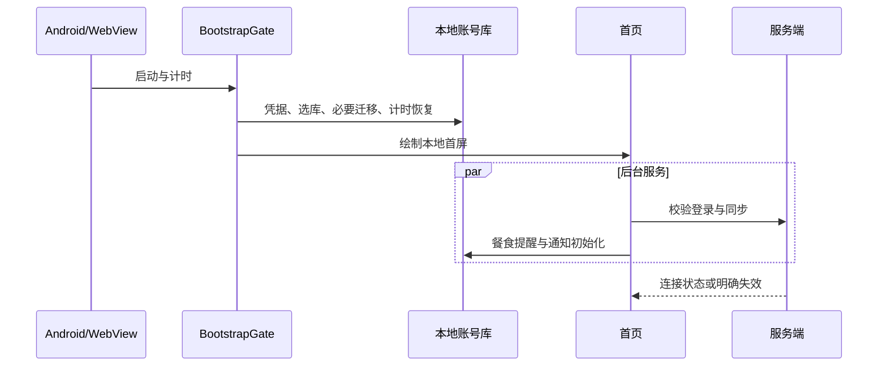

## Context

`ui/src/App.tsx` 通过 `BootstrapGate` 启动。`bootstrapApplication` 串行等待凭据视图、SQLite 初始化、餐食提醒对账和通知运行时安装；`BootstrapGate` 与安卓资料恢复阶段均仅绘制空白 `main`。`useSettings` 从账号库加载资料后发起 `/auth/me` 连接检查，`AppSession` 通过 `resolveSavedSession` 允许已保存 token 在离线/检查中恢复。当前没有实机阶段耗时证据；`adb devices` 未发现连接设备。

## Goals / Non-Goals

**Goals:** 量化冷启动各段耗时；消除可安全推迟的首屏阻塞；避免保存登录态闪现登录页；在等待期间给出状态；保持升级、离线和计时安全。

**Non-Goals:** 修改服务端登录协议、跳过数据库兼容迁移、删除通知与餐食功能、改变 PC 启动行为。

## Decisions

1. **先测再改。** 以单调时钟记录原生 Activity/WebView 可见、JS 入口、凭据、数据库、提醒、通知、资料恢复、计时页首帧/可操作的阶段耗时。日志仅记阶段和毫秒，不输出 token、用户名或库内容。实机同版本同账号同网络做至少 5 次冷启动基线；以中位数和最慢一次比较。相比直接延时隐藏登录页，计时能定位真正阻塞点。
2. **首屏只等待数据正确性所需操作。** 凭据与账号库选择、SQLite 必要迁移、计时恢复保留在门内；餐食提醒对账与非关键通知注册在首屏后安排，失败有可重试日志。若测得数据库 DDL/迁移为主要耗时，再定向优化幂等检查或调用批量化，不能跳过迁移。相比一次性并行所有步骤，依赖顺序和数据安全明确。
3. **保存会话不依赖网络首轮结果。** 已有账号资料且 token 时，在资料恢复完成后直接用 `resolveSavedSession` 进入本地首页；连接检查后台更新状态，只有明确 401/身份不符才清理。无 token 时直接登录页。相比等待 `/auth/me`，离线启动可用且不会出现登录页闪屏。
4. **等待状态可见。** 以轻量启动画面显示应用名和“正在恢复本地数据”，错误保留重试入口，不加载重型页面资源。安卓专用，PC 保持现状。

## Risks / Trade-offs

- [后台任务晚于首屏] → App 生命周期监听与幂等注册；前后台切换及进程重建用实机验证。
- [旧库迁移本身耗时] → 保留门槛并做定向 DDL 优化，不以绕过迁移换速度。
- [离线使用过期 token] → 与现有离线语义一致；明确 401 后退出，所有服务端写入仍需认证。
- [设备差异] → 同设备、同数据、同网络基线；报告硬件与构建条件，不把模拟器数字当实机结果。

## Migration Plan

先加诊断并取基线，再小步调整、回归和重测；仅客户端更新。回滚为撤销提交并重建安卓包，无数据迁移。

## Open Questions

具体最慢阶段和能否达到目标耗时须接入老板实际安卓设备后确定；若无设备，先完成可证明的代码路径优化，实机验收保持未完成。
