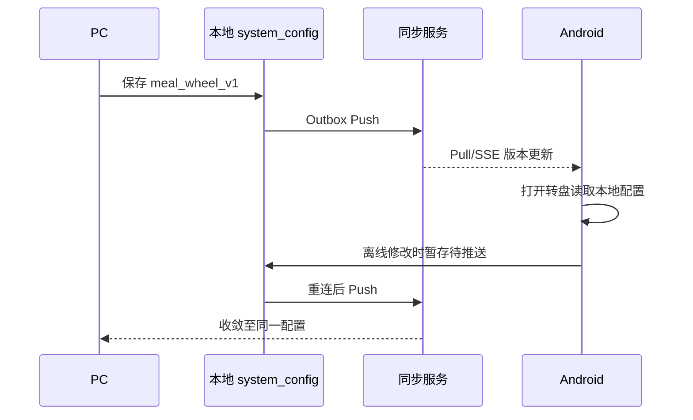

## Context

截图顶部为共享 `PageQuickActions`，由 `MainLayout` 同时用于 PC 与安卓。`SettingsPage` 是现有设置入口；`Database.setConfig` 对非设备本地 key 写入 `system_config` 并入同步 Outbox，契约中的 `system_config` 为双向同步。需在实施时验证新 key 在服务端过滤和跨端合并中可用。

## Goals / Non-Goals

**Goals:** 快捷入口、可编辑候选及权重、可读实际概率、顺滑转盘动画、按账号多端同步和离线可用。

**Non-Goals:** 金币/奖励结算、真实抽奖、自动创建用餐记录、第三方服务。

## Decisions

1. **一份按账号同步的 JSON 配置。** key 为 `meal_wheel_v1`；结构含 schemaVersion、items（稳定 id、名称、整数权重、顺序）与 updatedAt。使用 `Database.setConfig/getConfig` 复用现有 `system_config` 双向同步，不引入新表和 API。相较设备 Preferences，本方案可跨端传播并保留账号隔离。跨设备同时修改按现有记录级 LWW 收敛；编辑界面在远端版本改变时提示重新载入，避免无提示覆盖。
2. **权重规则。** 允许 2–12 项，名称去空白后 1–20 字且不可重复，权重为 1–100 的整数；概率 = 本项权重 / 总权重，显示到 0.1%，最后一项补足显示舍入差。默认 6 项只在没有配置时展示，保存后成为账号配置。选择由安全随机数按累计权重决定，动画停在已选项；扇区面积按概率绘制，极小扇区的名称在旁侧列表保留可读性。
3. **界面复用。** 在 `PageQuickActions` 的奖励图标后插入转盘按钮；在主布局挂载非阻塞面板，在设置页新增入口和编辑面板。CSS/ SVG 使用现有主题语义，不新建 Electron 窗口；窄屏快捷栏优先保持按钮可点，必要时缩短同步状态与金额显示。
4. **同步时序。** 保存本地后沿现有 Outbox 推送；其他设备通过现有 Pull/SSE 收敛。转盘每次打开读取最新本地配置，面板打开时收到配置更新则刷新；编辑中的草稿检测版本变化，提示重新加载或确认覆盖。离线抽取照常工作，保存离线配置后显示待同步状态。

## Risks / Trade-offs

- [整份配置并发编辑采用 LWW] → 草稿版本提示与覆盖确认；测试离线双端编辑后的最终一致性。
- [旧客户端未知配置 key] → 与旧客户端互不影响；验证服务端不会过滤该 key。
- [小概率扇区难读] → 旁侧候选概率列表，结果用文字和动画双重表达。
- [随机边界偏差] → 使用无偏区间采样与纯函数边界测试，不由动画决定结果。

## Migration Plan

无配置的账号展示默认候选；首次保存写入 `meal_wheel_v1`。先验证现有服务端可推拉新 key，再发布 PC/安卓包。回滚客户端后留存未知配置 key，旧版继续运行。

## Open Questions

默认候选名称可在实施阶段按通用餐食给出，老板之后可在设置页全部改写。
