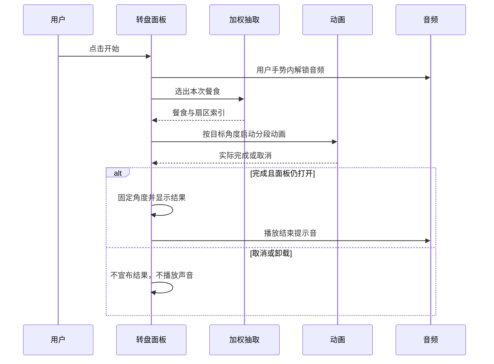

## Context

`MealWheelSheet` 在点击时先用 `pickMealWheelItem` 选出结果，再把整个 SVG 的 `transform` 交给一段 4000 ms CSS transition；另一个 `setTimeout` 在固定时刻显示结果。停止事件与实际绘制没有绑定，也没有音效。转盘的账号配置、概率和同步已经实现，本次只处理 PC Electron 与安卓 WebView 的交互反馈。

## Goals / Non-Goals

**Goals:** 转动有加速、稳定旋转和自然减速；低帧率与切后台时结果仍与指针一致；停稳后有简短音效，尊重现有静音设置；不影响抽取概率。

**Non-Goals:** 不更换数据模型、不改服务端、不增加奖品/账本操作、不自动播放背景音乐。

## Decisions

1. **保留 SVG 与现有抽取函数，改用 Web Animations API 控制旋转。** 按当前累计角度与已选扇区中心计算目标角度；将加速、巡航、减速拆为多个关键帧，使用 `Animation.finished`/`finish` 事件确认落点，再显示结果。取消或卸载时取消动画并清理引用；减弱动态效果时直接落点。这样选择逻辑仍由现有加权随机函数控制，CSS 合成层负责逐帧旋转，React 只在开始和结束更新状态。若目标 WebView 对 SVG 的 WAAPI 支持不足，验收时以同样起终角度的 `requestAnimationFrame` 驱动作为回退。
2. **点击开始时解锁音频，停稳后合成短提示音。** 在用户手势里创建或恢复 `AudioContext`；结束时播放两音短促提示并释放节点。沿用现有 `audio_coin`/`victory` 静音开关，播放失败只记录诊断，不影响结果显示。音频上下文在面板关闭时挂起或复用，避免重复创建。
3. **开源组件研究结论：先不替换现有转盘。** [react-custom-roulette](https://github.com/effectussoftware/react-custom-roulette) 为 MIT，提供指定结果与 `optionSize`；但本项目最高 12×100 权重，按文档会映射为大量“pieces”，需先验证渲染成本和样式兼容。[canvas-spin-wheel](https://github.com/wheelofnames-io/canvas-spin-wheel) 为 MIT，提供权重、物理减速和跨扇区回调，但 `spin()` 自行选择结果、未暴露指定赢家方法，且仓库目前规模很小。[react-prize-wheel](https://github.com/mertercelik/react-prize-wheel) 为 MIT，内置权重和动画，但引入 GSAP，并由组件控制抽取。以上为官方文档所示能力与本项目需求的匹配推断，未在本项目完成性能实测。保留现有 SVG 可最小化依赖和同步风险。

### 时序

## Risks / Trade-offs

- [WebView 动画支持差异] → 在 PC 与安卓实测；必要时同公式回退 `requestAnimationFrame`，仍以动画结束时点为准。
- [音频自动播放限制或静音配置] → 在点击手势中恢复 AudioContext；禁音或失败时保持文字结果可用。
- [远端配置在旋转期间更新] → 本次旋转锁定开始时的配置快照，结束后刷新配置供下次抽取。
- [低性能设备帧率下降] → 只动画外层 `transform`，不逐帧 React 渲染；记录 2、6、12 项的 PC/安卓观感。

## Migration Plan

无数据迁移。通过现有 PC 与 Android 构建发布；回滚时只恢复本变更的转盘面板和音频函数。

## Open Questions

无阻塞项；音效采用可关闭的短提示音，不新增用户设置。
