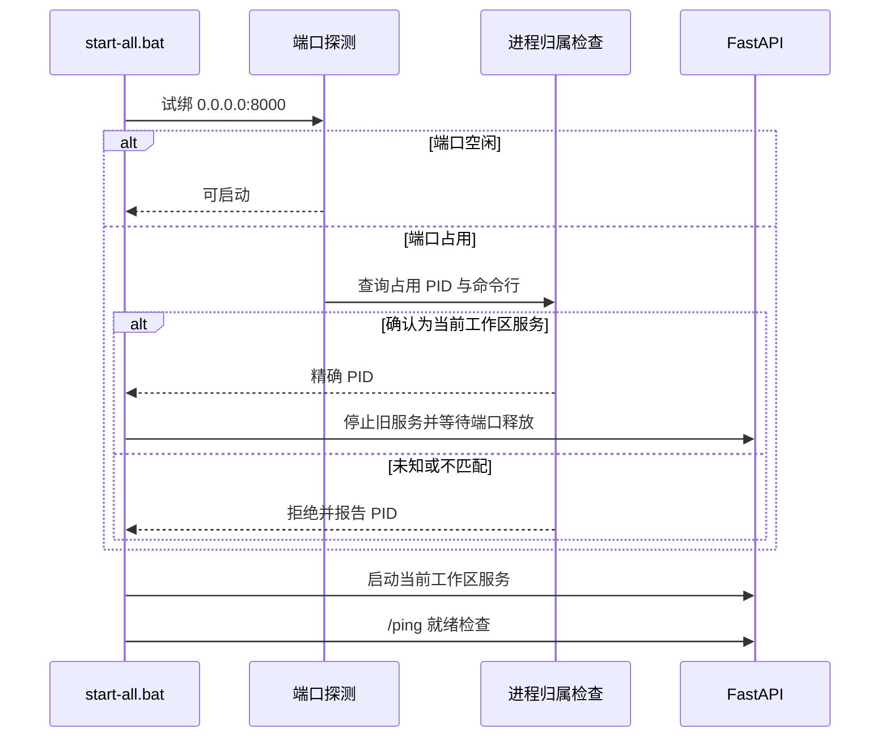

## Context

现场 `Get-NetTCPConnection -LocalPort 8000` 返回 `0.0.0.0:8000` 与 PID 23936，`State` 却为空；`-State Listen` 返回空。现有 `start-local-process.ps1` 据此跳过旧服务识别，新进程启动后绑定失败；`wait-local-readiness.ps1 -RequirePortsFree` 有同类误判。PID 23936 的命令行与工作目录均属于此项目，`/ping` 正常。

## Goals / Non-Goals

**Goals:** 同项目重复启动可安全更新服务；未知进程占用时明确拒绝；就绪前检查与实际绑定行为一致。

**Non-Goals:** 不改变服务端口、不改应用 API、不处理其他软件进程。

## Decisions

1. **绑定探测是端口可用性的依据。** 使用与 Uvicorn 相同的 `0.0.0.0:8000` 尝试短暂绑定；成功立即释放，失败视为占用或排除端口。相比只依赖 `Get-NetTCPConnection -State Listen`，此法能覆盖本机状态字段为空的现象。Vite 端口选择已有同类探测，无需改动。
2. **占用时只处理精确确认的本项目进程。** 从不带 `-State` 的 TCP 记录取 `LocalPort=8000` 且 `RemotePort=0` 的 OwningProcess；核验其命令行包含 `uvicorn server.server:app` 及本工作区的 `--app-dir`。未知 PID、无归属或多进程混用均报错。核验后仅停止该 PID，再循环绑定探测直至端口释放。
3. **预检共用相同端口探测语义。** `wait-local-readiness.ps1 -RequirePortsFree` 对需要空闲的端口直接试绑，不因 TCP 状态枚举异常而漏报。正常就绪检查仍同时验证已跟踪进程、`/ping` 构建版本和 Vite URL。

## Risks / Trade-offs

- [探测和启动间端口竞争] → 启动后仍检查子进程与 `/ping`，失败给出归属信息；不宽泛杀进程。
- [进程命令行不可读取] → 视为未知占用，停止流程并报告 PID。
- [已运行服务被重启] → 仅在工作区和命令匹配后执行，符合一键启动加载当前代码的预期。

## Migration Plan

无迁移。验收重复启动、未知占用与端口排除情形后提交；回滚只恢复两个 PowerShell 脚本。

## Open Questions

无。
