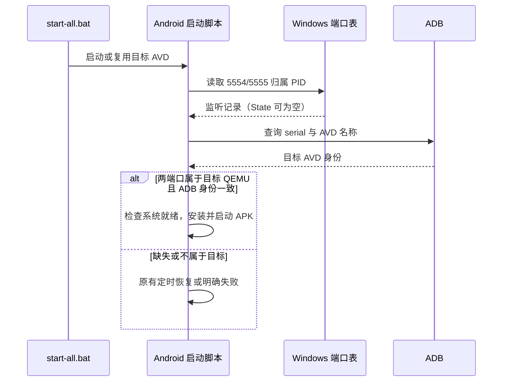

## Context

`Get-TargetAvdSerial` 当前先运行 `adb devices`，再用 `Get-NetTCPConnection -State Listen` 标记 5554/5555。`Wait-ForTargetAvd` 只有端口标记和 serial 都成功才查询系统就绪。现场目标 QEMU PID 3688 独占两个端口、ADB 能返回正确 AVD 和 `sys.boot_completed=1`，但连接记录 `State` 为空，45 秒后脚本误入传输恢复，最终报 `adb_transport_unavailable`。

## Goals / Non-Goals

**Goals:** 不依赖 Windows `State` 字段识别目标模拟器监听端口；确认端口归属目标 QEMU，避免复用另一台占 5554 的模拟器；端口真缺失时沿用既有恢复策略。

**Non-Goals:** 不改变目标 AVD/serial/端口选择、ADB 服务端端口、模拟器数据、App 或同步协议。

## Decisions

1. `Get-TargetAvdSerial` 继续用 `adb devices` 获取 transport，但查询 5554/5555 时不传 `-State Listen`，仅取 `RemotePort=0` 且 `OwningProcess` 等于 `Get-TargetEmulatorPid` 的监听记录。该 PID 已由命令行中的目标 AVD 名称、端口和 QEMU 进程身份核实。端口不归目标进程时保持 missing，不终止占用者。
2. 对 ADB serial 再核对 `adb emu avd name` 与目标 AVD 名称，防止另外一台模拟器先占 `emulator-5554` 时被误复用；查询失败时返回未就绪，交由原有恢复和错误路径处理。
3. 用 PowerShell 模拟连接表的 `State=$null`、正确/错误 PID、缺端口和 ADB 名称；随后在目标模拟器上运行完整启动验收。现有 `-DryRun`/`-TestScenario` 保持兼容。

## Risks / Trade-offs

- [短暂端口重建] → 下一轮轮询重查 PID 和 ADB，不沿用旧连接表快照。
- [ADB 两个服务端同时访问模拟器] → 以脚本固定的 5038 为准，验证身份后再判断就绪。
- [目标 AVD 尚未监听] → 保留 45 秒等待与既有有限恢复，不误报成功。

## Migration Plan

无数据迁移。回滚脚本与测试文件即可；目标模拟器和已安装 APK 不变。

## Open Questions

无阻塞问题；本次不解决多模拟器同时占用固定 5554 的配置选择。
