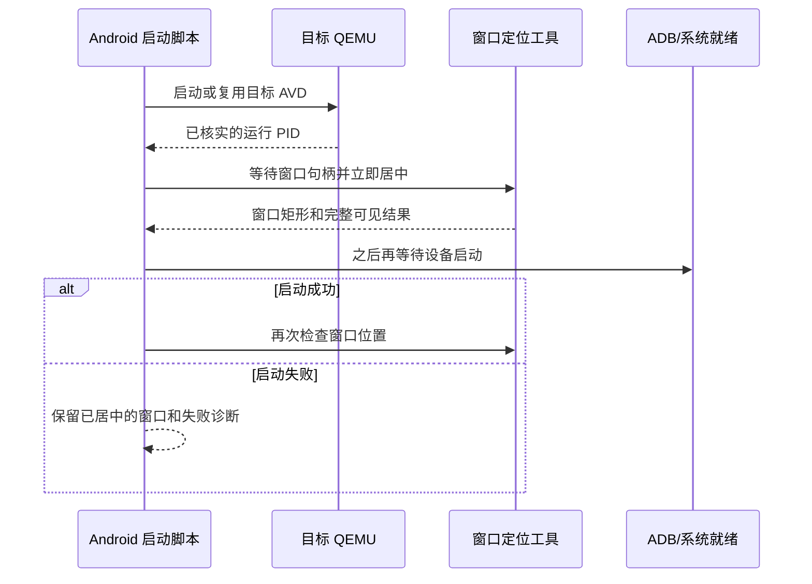

## Context

`Start-TargetAvd` 最多约两秒后就取得目标 QEMU 的 PID；当前紧接着调用 `Wait-ForTargetAvd`，最长等待 180 秒，且可能因传输检测失败提前退出。`Request-TargetEmulatorForeground` 被安排在等待成功之后。现场 QEMU PID 17664 的窗口矩形为 `516,-826,1008,275`；单独运行已有 `ensure-window-visible.ps1` 后变成 `755,51,1165,969`，位于 1920×1020 工作区中央，因此定位函数有效，调用顺序错误。

## Goals / Non-Goals

**Goals:** GUI 窗口一旦出现便完整居中并获得前台焦点；已运行的目标 AVD 同样立即居中；设备启动或 ADB 检查失败不妨碍窗口显示。

**Non-Goals:** 不改模拟器本身的启动条件、端口检测、设备系统启动判定、APK 内容或用户其他窗口。

## Decisions

1. `Start-TargetAvd` 返回已核实的目标 QEMU PID 后，立即进入新的 `foreground_launch` 阶段并调用现有 `Request-TargetEmulatorForeground`，再进入 `boot_wait`。启动成功后的 `foreground_boot` 与 `foreground_request` 保留，处理后续窗口几何变化。使用同一目标 PID 和同一窗口定位工具，避免出现两套坐标算法。
2. 将现有短重试窗口扩至有界约 15 秒，只等待目标 GUI 句柄出现；句柄可用时立即返回。窗口不可用时写明 PID 和原因，启动流程继续，但不把未显示的窗口误报为已居中。已有目标 AVD 复用路径也走同一调用。
3. 扩展现有窗口边界测试，验证早期阶段位于 `avd_acquisition` 和 `boot_wait` 之间；现场测试以目标 QEMU 的实际 `GetWindowRect` 和工作区判定为准，并记录阶段顺序。即使后续 ADB 检查失败，早期居中仍须验收。

## Risks / Trade-offs

- [窗口句柄比 QEMU 进程晚出现] → 有界重试并在出现时立即定位，不用固定睡眠。
- [模拟器稍后自行恢复旧几何] → 保留已有后续两次定位；现场记录冷启动后的矩形稳定性。
- [前台抢焦点] → 只对用户请求启动的目标 AVD 执行，定位成功后停止重试。

## Migration Plan

无迁移。撤销新增的早期调用和重试调整即可回滚；窗口位置不写入业务数据。

## Open Questions

无阻塞项。被用户取消的 Android 端口检测提案不在此变更中。
