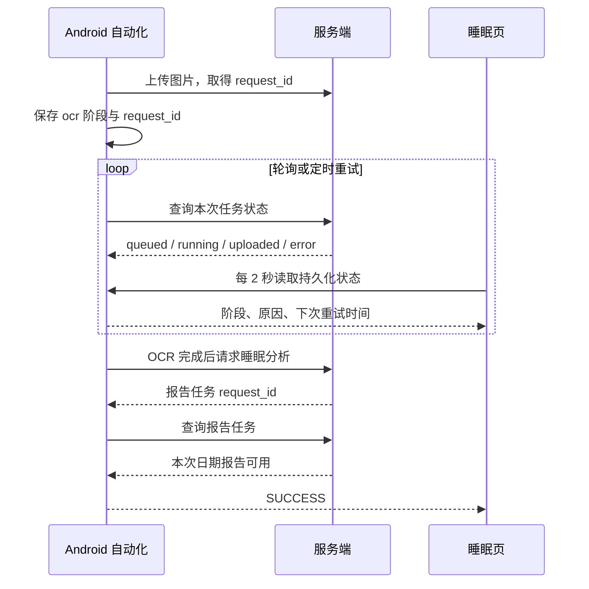

## Context

`useGoals.command` 直接调用 WebView `fetch`；Android 的 `platformFetch` 已通过 CapacitorHttp 发送请求，`protectedPlatformFetch` 还负责 401 通知。睡眠页面每 2 秒读取原生状态，文案只按 `mode` 映射。原生顺序流程上传后保存 `mode=ocr`，轮询 `queued/running` 时安排重试，直到状态为 `uploaded` 才进入 `ocr_ready`；当前提示未说明任务编号、重试及实际服务端阶段。

## Goals / Non-Goals

**Goals:** 目标写操作可靠到达当前环境服务端，失败原因可辨；睡眠自动化在 OCR、报告请求、重试和完成各阶段显示可信状态。

**Non-Goals:** 改动目标奖励计算、OCR 识别算法或重建旧报告。

## Decisions

1. 目标命令复用 `protectedPlatformFetch`，保留现有 POST/PUT/DELETE API 与服务端校验。网络异常用 `formatPlatformNetworkError` 呈现；将服务端写入成功与后续 `pullSync` 失败区分，避免把已保存误报为未保存。备选方案是为目标单独实现 Android HTTP；会重复已有通道。
2. 睡眠状态以原生持久化任务为主，并用同一 `requestId` 查询服务端状态。原生阶段必须随上传回执、OCR 完成、报告请求和报告完成推进；排队与重试显示具体阶段和下次重试时间。仅在本次日期及任务的报告内容可用时宣告成功。备选方案只改前端文案；无法修复状态滞留。
3. 先检查实机同日期状态、`requestId`、服务端 job 与日志，再针对确证卡点收窄原生修复。若本次 OCR 仍在运行，应继续等待/重试，不自动重复上传。

## Risks / Trade-offs

- [写入成功但同步失败] → 单独提示同步待重试，勿让用户重复提交目标。
- [服务端任务慢于手机轮询窗口] → 保留 request_id 并定时重查，展示下次重试时间。
- [旧报告误判本次完成] → 以本次 request_id、日期和报告状态联合判定。
- [切换账号或环境] → 保持现有 owner 隔离，状态不得跨账号复用。

## Migration Plan

无需数据迁移或服务端协议变更。先在 Android 调试版验证，再交付 APK；回滚客户端提交及 APK。已有上传任务应继续沿原 request_id 恢复，避免重复上传。

## Open Questions

截图无法证明服务端本次 job 状态。实施阶段需取实机状态与服务端同 request_id 记录，确认是 OCR 耗时、重试调度、状态推进还是报告请求问题。
