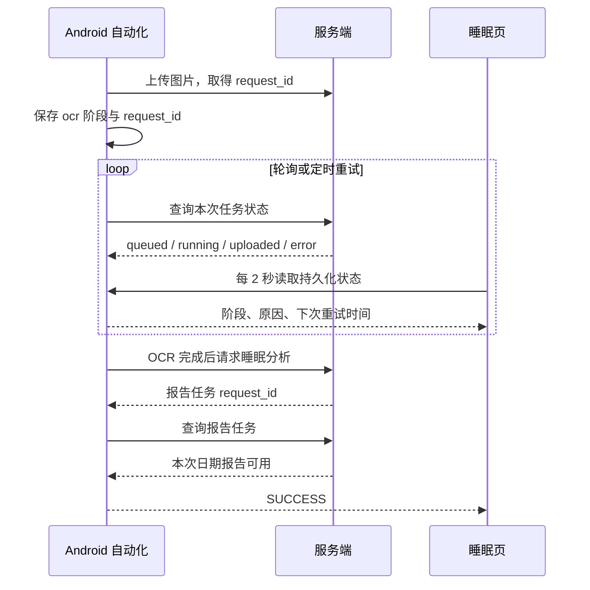

## Context

`useGoals.command` 直接调用 WebView `fetch`；Android 的 `platformFetch` 已通过 CapacitorHttp 发送请求，`protectedPlatformFetch` 还负责 401 通知。PC 与开发环境 Android 保存正常，测试环境 Android 失败，故还需对比本地数据库保存的环境配置和服务器地址。睡眠页面每 2 秒读取原生状态，文案只按 `mode` 映射。`server/store.py` 的固定补偿说明只在 `INSERT OR IGNORE` 首次创建时写入，旧账户不会自动更新。商店自填消费已有必填备注，但金额与备注同时显示。`morningNotifications` 每日安排 08:40 体重体脂通知。

## Goals / Non-Goals

**Goals:** 目标写操作可靠到达当前环境服务端，失败原因可辨；睡眠自动化在 OCR、报告请求、重试和完成各阶段显示可信状态；补偿规则清晰且旧账户可见；自填消费分两步填写；体重体脂通知停止出现。

**Non-Goals:** 改动目标奖励计算、OCR 识别算法、重建旧报告或自动发放补偿金币。

## Decisions

1. 先从开发与测试环境的 Android 本地配置只读提取 `active_environment` 和 `server_url`（遮蔽 token），对比相同操作是否抵达服务端、请求方法/状态与网络策略；再让目标命令复用 `protectedPlatformFetch`，保留现有 API。网络异常用 `formatPlatformNetworkError` 呈现；将服务端写入成功与后续 `pullSync` 失败区分。备选方案是为目标单独实现 Android HTTP；会重复已有通道。若发现测试环境 URL 配置错误，先修复配置并记录，代码改动仍以确证根因为准。
2. 睡眠状态以原生持久化任务为主，并用同一 `requestId` 查询服务端状态。原生阶段必须随上传回执、OCR 完成、报告请求和报告完成推进；排队与重试显示具体阶段和下次重试时间。仅在本次日期及任务的报告内容可用时宣告成功。备选方案只改前端文案；无法修复状态滞留。
3. 先检查实机同日期状态、`requestId`、服务端 job 与日志，再针对确证卡点收窄原生修复。若本次 OCR 仍在运行，应继续等待/重试，不自动重复上传。
4. 固定补偿商品文案在创建时及既有账户同步时统一更新，只修改系统固定 ID 的说明，保留用户商品及流水。四条规则逐条显示：① 找工作直接相关造成的当日金币损失；② 外部不可抗力造成的当日金币损失；③ 初始化后一次性补偿 200 启动金币；④ 副业实际收入按收入金额等额补偿金币。第五条单列“例如”，说明面试导致运动或睡眠指标未达标而扣金币。前两条限定当日损失，第三、四条不受此限定。现有人工补偿仍需金额和原因，不自动入账。
5. 自填消费沿用现有金额校验、备注字段和购买 API，把确认面板拆成金额→备注两步；返回修改金额时保留已填内容，失败时保留备注。备选方案是在原面板突出备注，但不符合“填写后弹窗”的交互。
6. 从每日通知源去掉体重体脂事件，同时在通知运行时取消今天与次日已排程的对应 eventKey；睡眠截图等提醒保持原计划。只删源事件会让旧设备的已排程通知继续弹出。

## Risks / Trade-offs

- [写入成功但同步失败] → 单独提示同步待重试，勿让用户重复提交目标。
- [服务端任务慢于手机轮询窗口] → 保留 request_id 并定时重查，展示下次重试时间。
- [旧报告误判本次完成] → 以本次 request_id、日期和报告状态联合判定。
- [切换账号或环境] → 保持现有 owner 隔离，状态不得跨账号复用。
- [旧账户补偿文案滞后] → 对固定 ID 执行受控回填并发送同步变更；不覆盖非固定商品。
- [旧通知仍在系统队列] → 取消已排程体重体脂通知，并验证 08:40 后不弹出。

## Migration Plan

无需数据库结构迁移或 API 协议变更；固定补偿说明需一次性回填并同步。先在 Android 调试版验证，再交付 APK；回滚客户端提交及 APK，文案按旧值回写。已有上传任务应继续沿原 request_id 恢复，避免重复上传。

## Open Questions

截图无法证明服务端本次 job 状态；目标的测试环境失败也尚缺请求日志。实施阶段分别核对实机/服务端同 request_id 与开发/测试环境目标请求，再确定最终修复范围。
