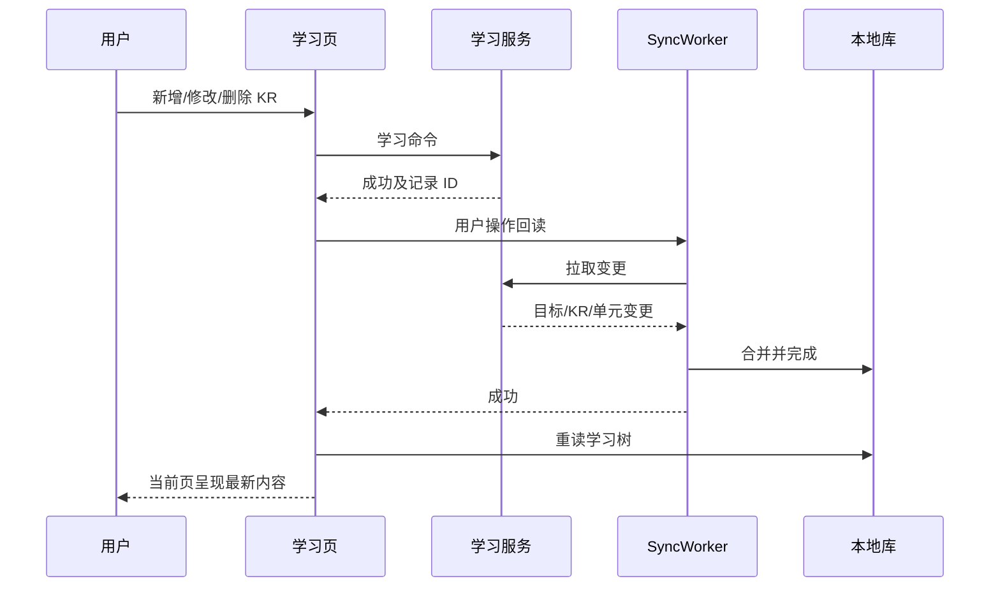

## Context

`useLearning.command` 在服务端命令返回后调用 `pullSync()`，随后增加 `refreshTrigger`，`loadObjectives` 从本地库重建目标/KR/学习单元树。`pullSync()` 以 `server-readback` 发起非强制拉取；`SyncWorker.pullAndMergeResult` 对此原因允许短时间去重并返回 `merged=0`。因此页面可能先重读旧库，直到切页重挂载才看到新增内容。此为代码层根因假设，实施时用连续新增复现并核对同步诊断。服务端 `LearningPlanService.command` 支持 `create_kr`，不支持 `update_kr`、`delete_kr`；KR 卡片也没有相应操作。

## Goals / Non-Goals

**Goals:** 新增或导入后当前学习页及时显示已确认数据；每个 KR 可修改标题、确认删除；所有写入按账号隔离并同步到其他端。

**Non-Goals:** 自动合并重复 KR、调整学习数据模型、重新设计同步协议、重做页面样式。

## Decisions

1. 学习命令使用明确的用户操作回读方式，绕过被动同步去重窗口；等待拉取与本地合并成功后再更新列表。优先在 `pullSync` 增加可选调用意图，仅由学习页使用，保留其他调用者行为。若同步失败，显示可理解的错误并允许重试；不伪称页面已更新。避免对所有同步调用强制全量刷新。
2. `LearningPlanService.command` 增加 `update_kr` 与 `delete_kr`。修改仅允许非空标题；删除先校验 KR 属于当前账号，在同一事务内删除其学习单元、关联记录及 KR，逐项发布删除变更。独立清单任务和历史流水保留；若存在学习清单关联，仅移除关联。沿用现有 `delete_objective` 的子项删除和同步日志模式，补足关联清理。
3. KR 标题栏右侧提供修改和删除按钮。修改使用预填标题的轻量编辑框；删除显示 KR 标题及将删除的学习单元数量，要求显式确认。提交期间禁用重复触发；失败时保留原内容并显示错误。成功后复用上述服务端回读路径。
4. 客户端学习树的删除变更按学习单元、KR、目标顺序合并，以满足本地外键；非删除记录仍按原有父到子的顺序合并。

## Risks / Trade-offs

- [额外一次回读增加短时请求] → 只对学习命令使用用户操作回读，依旧按服务端版本增量拉取。
- [删除 KR 连带删除学习单元] → 明确展示数量并二次确认，服务端事务化处理；保留独立清单与历史流水。
- [服务端成功而本地同步失败] → 保留错误提示与重试入口，避免用户误以为命令未提交而重复创建。
- [本地外键阻止先删父项] → 将学习树删除变更置于子项优先阶段，并用启用外键的 SQLite 回归验证。

## Migration Plan

先发布服务端 KR 命令，再发布共享 UI；旧客户端不调用新动作，新增命令不改变旧行为。无需数据库迁移。回滚时先回退客户端，再回退服务端；已删除记录只能从备份恢复。

## Open Questions

无阻塞项。实施前核对当前学习清单关联表的删除约束，并用连续快速新增验证去重路径。
