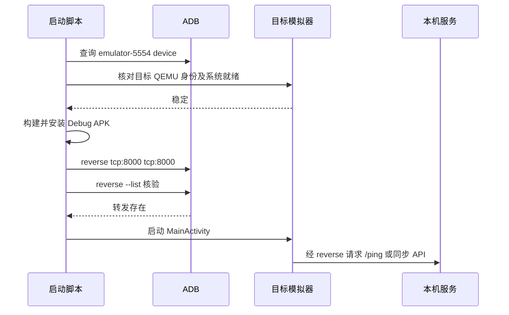

## Context

失败摘要 `android-20261107-001932.summary.json` 在 `transport_wait` 报 `5554=missing,5555=missing`。目标 QEMU PID 30996 实际持有两个端口，`adb devices` 能显示 `emulator-5554 device`，但 PowerShell `Get-NetTCPConnection` 对这些记录返回空 `State`，脚本使用 `-State Listen` 因而漏检。`Wait-ForTargetAvd` 将端口诊断作为就绪门槛，恢复一次后仍报错；`Start-AndroidApp` 尚未执行，`adb reverse` 为空。手动转发在后续 ADB 重连后也消失过。此结论仅适用于目标模拟器，实体手机需独立网络诊断。

## Goals / Non-Goals

**Goals:** 正确识别目标模拟器已就绪，顺利完成构建/安装；在报告 Android 可用前核验本机 HTTP 转发。

**Non-Goals:** 放宽目标 AVD 身份校验、处理其他模拟器或实体手机、修改服务端和学习业务。

## Decisions

1. 使用 `adb devices` 中目标序列号为 `device`、目标 AVD 的已确认 QEMU 进程，以及现有系统启动/窗口稳定采样作为必要条件。5554/5555 端口仍用于诊断，但空 `State` 不得否决 ADB 已确认的连接。备选方案是改为端口所有者判断；ADB 实际传输状态更接近启动脚本需要的事实，且现有身份函数已检查目标进程。
2. `Start-AndroidApp` 先设置 reverse，再读取 `adb reverse --list` 确认目标 `tcp:8000 → tcp:8000`，然后启动 Activity。若后续输入恢复导致 ADB 重连，现有恢复路径再次运行同一函数。备选方案是把开发地址改为 `10.0.2.2`；当前尚无模拟器内直接 HTTP 验证，因此先保持项目既定的 reverse 路径。
3. 对目标 AVD 做一次真实启动验收，并检查启动摘要中的 `activity_foreground`、转发列表、本机 `/ping`，再观察 App 的新同步时间；不以旧的“已同步”文案单独证明连通。

## Risks / Trade-offs

- [ADB 显示 device 但系统尚未可操作] → 继续使用已有两次系统窗口稳定采样与输入就绪检查。
- [转发在配置后再次丢失] → 恢复路径重新配置，并在最终启动摘要记录转发状态；若仍复现，再分析重连来源。
- [实体手机无法使用 emulator reverse] → 本变更限定目标模拟器，实体手机使用其可达的服务端地址另行诊断。

## Migration Plan

仅更新本地开发脚本，不涉及安装包数据或服务器迁移。回滚脚本提交即可恢复旧流程。

## Open Questions

老板提到的“安卓端”是否指截图中的模拟器；当前 ADB 仅识别模拟器，已请求澄清。若指实体手机，需要补充手机服务器地址和网络状态，不套用模拟器方案。
