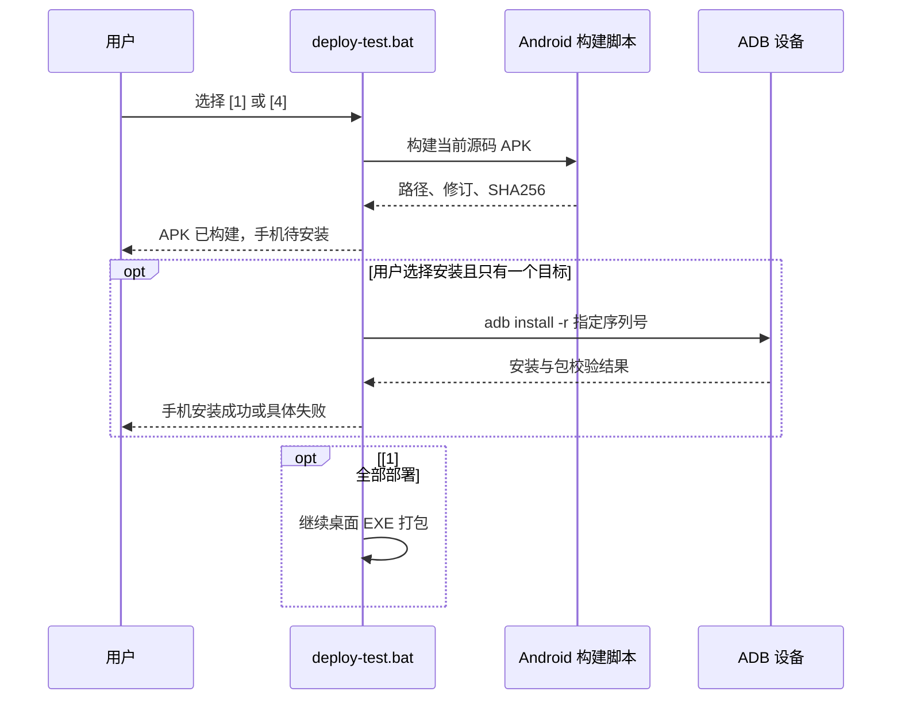

## Context

`deploy-test.bat` 的 [1] 顺序为服务端→桌面 EXE→Android APK；桌面打包长时间无进展会挡住 Android。`deploy/build-android.ps1` 构建后仅复制到 `deploy/artifacts/MyTimeLogger-debug.apk`。当前 APK 的 JS 含“选餐转盘”和“转盘设置”，但截图手机看不到，且 ADB 无连接设备，无法证明手机安装版本。

## Goals / Non-Goals

**Goals:** 明确产物与设备安装状态，让 Android 构建不排在可能卡住的桌面打包之后；可对明确选择的唯一设备安装并验收。

**Non-Goals:** 不修复 electron-builder 自身停滞，不清除手机数据，不改变服务器与转盘功能。

## Decisions

- [1] 保持服务端先行，将 Android 构建移至桌面打包之前；Android 成功即打印产物、Git 修订和 SHA256。备选为继续现有顺序并等待桌面失败后再构建，不能处理无错误但无限等待的情况。
- 安装必须是明确的菜单选择；仅接受一个处于 `device` 状态的 ADB 序列号，输出序列号供确认。`adb install -r` 成功后核验包仍在目标设备；零/多设备或签名不兼容则报告“待安装”，保留 APK，不做卸载。备选为自动安装任意连接设备，可能更新错设备。
- [1]/[4] 分别报告“构建成功”“安装成功”“待安装”；全部部署的成功结论依旧要求各选中阶段成功。日志不包含私有配置值。

## Risks / Trade-offs

- [手机未接入 ADB] → 输出 APK 绝对路径与手工安装提示，不能宣称手机已更新。
- [安装签名不匹配] → 停止设备安装并报告原错误，不卸载旧 App。
- [桌面打包继续停滞] → Android 产物已生成，但整套任务仍不得报告全部完成。

## Migration Plan

批准后改部署脚本并在无设备/单设备/多设备模拟条件下验证；手机接入后再现场安装及检查 🎡、设置项。回退脚本即可恢复原顺序和输出，无数据迁移。

## Open Questions

无。
