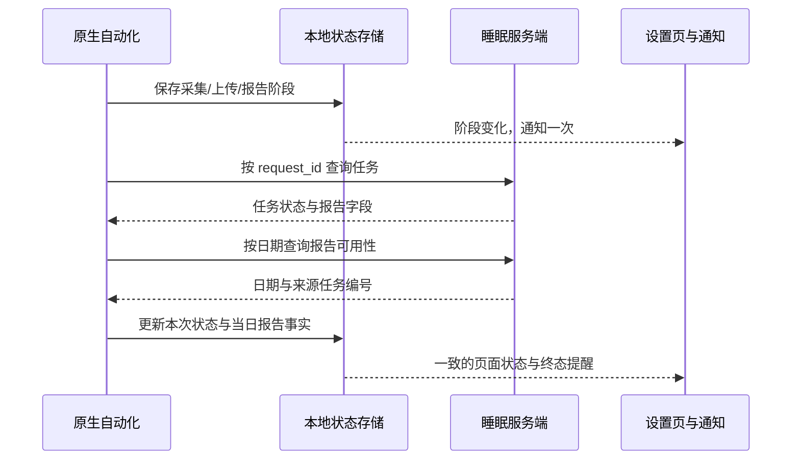

## Context

设置页 `canGenerateSleepReport` 只读手动 `captureTest`，而自动化图片存于 `SleepAutomationSnapshot.mediaUri`；图 2 因而同时显示“图片已确认：是”和“尚未确认”。`SleepAutomationBridge.status()` 只返回本地快照，`POLLING` 与 `nextRetryAt` 可在服务端报告完成后继续滞留。原生服务主要在前台低重要性通知中更新阶段，单独弹出的通知集中在采集和最终结果。

## Goals / Non-Goals

**Goals:** 页面按同日同任务展示准确状态；手动与自动采集分开；实际阶段变化逐次提醒；完成/失败/待核对互不混淆。

**Non-Goals:** 不改变分析模型、历史报告内容或现有接口字段含义；不把同日其他任务的报告标成本次任务成功。

## Decisions

- 为页面建立“本次任务状态”和“当日报告可用性”两个独立事实。现有 `_public_job` 会把同日数据库报告回填到任何同日任务的 `result`；在回填前从任务原始报告字段计算新增布尔标记 `request_report_ready`，供 `/status/{request_id}` 判断本次成功。`/status_by_date/{date}` 只判断当日报告可用。不同编号的已生成报告显示为当日可用，但本次仍显示自身状态。备选为看到任一同日报告便改成功，会掩盖失败和串任务。
- App 恢复、打开设置页、重试触发异步核对，禁止网络请求阻塞 JS bridge 的同步 `status()`；网络不可达显示“待核对”和核对时间，不宣称未生成。过期重试时间清除或标记失效，不能继续作为“下次重试”。
- 手动采集测试独立展示；自动化 `mediaUri` 与日期确认可用时，不显示“今日图片尚未确认”的笼统警告。只有真正缺少可读图片且当日报告不可用时显示采集建议。
- 用阶段转移事件发布可见通知：待解锁/采集、图片保存、上传、OCR、报告生成、安排重试、成功或失败。按日期、任务编号、阶段去重，轮询不重复弹；前台通知和设置页由同一状态生成文案。Android 系统的展示样式可能受用户通知设置影响，客户端负责提交每次状态通知。

## Risks / Trade-offs

- [旧 APK 仍在手机] → 先验收安装版；新逻辑只对新 APK 生效。
- [服务端暂不可达] → 展示“待核对”并保留最后已知事实，下一次恢复时再核对。
- [旧客户端不识别新增字段] → 字段为可选扩展，不改变原有状态和 `result` 字段；新版客户端缺字段时不推断本次成功。
- [多次轮询造成通知轰炸] → 持久化阶段去重键并仅在转移时发通知。
- [按日期报告来自另一任务] → 独立展示可用性与任务状态，不伪造本次成功。

## Migration Plan

批准后先补定向复现测试，再改桥接/服务/设置页；模拟同任务完成、他任务完成、网络未知、跨日、失败与重试。实机需连接截图手机或手工安装新版 APK，按同日同任务编号对照服务端验收；回滚客户端 APK，不改数据结构。

## Open Questions

截图手机尚未接入 ADB，无法读取本次 `request_id`；现场验收时须确认报告属于同一任务还是同日其他任务。
