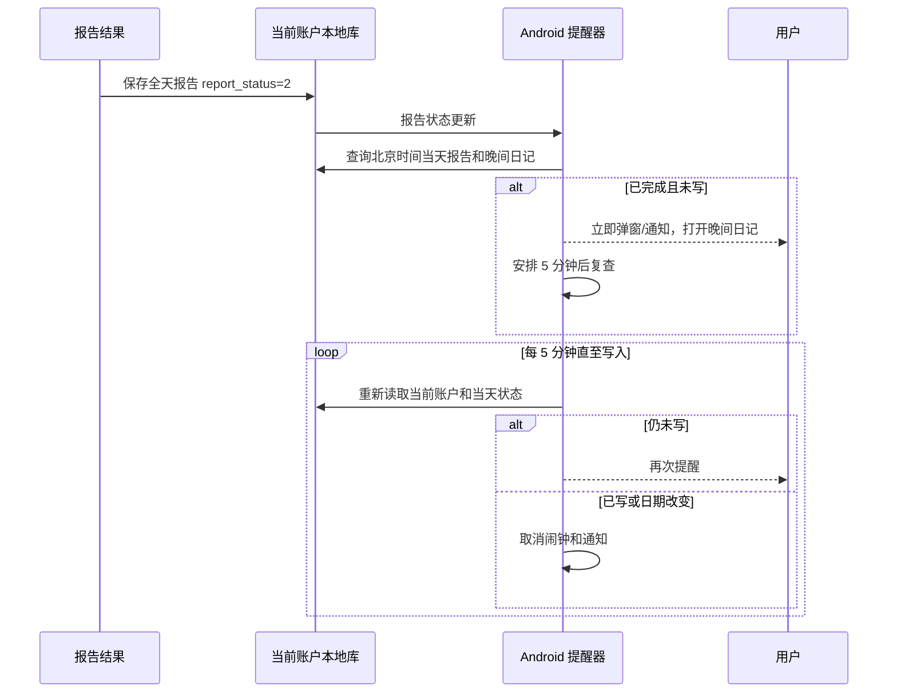

## Context

主页晚间日记在 `report_status >= 2` 时解锁，`evening_diary` 非空表示已填写。`MorningDiaryReminderReceiver` 已提供北京时间定时、后台通知和本地 SQLite 查询范例；现有自动化重排入口可在重启后恢复提醒。当前没有全天报告完成后的晚间日记提醒。

## Goals / Non-Goals

**Goals:** Android 在当天完整报告真实生成后立即提醒写晚间日记，此后五分钟一轮，直至保存非空内容；前台弹窗、后台通知均可直达编辑。

**Non-Goals:** 修改报告生成时间、服务端报告/奖励规则、PC 通知、自动替用户写日记。

## Decisions

- 以当前活跃账户本地数据库里北京时间当天 `report_status >= 2` 为报告完成依据，并要求 `evening_diary` 为空；只见到任务 `running`、快速报告或旧日期不触发。选择这个条件是因为主页解锁也用同一状态；备选为仅看自动化任务状态，可能在报告未真正保存时误提醒。
- 在报告结果落地/同步后启动提醒，前台显示可关闭的编辑引导弹窗，后台由独立 Android 接收器用高优先级通知提醒；每次触发重新查询状态，未写才计划五分钟后的下一次。保存非空日记后取消待触发闹钟和当前通知；若取消信号遗漏，下一次查询仍会自行停止。备选为只用 Web 计时器，应用进入后台后可能停止。
- 以“报告完成时刻 + 5 分钟”为后续节奏起点，首次完成时立即提示；提醒不跨北京时间日期，账户切换、重启、时区变化时重排/清理。数据库不可读时不宣称“未写”，待下一次可读时再核对，避免误提醒。
- 通知点击打开晚间日记编辑；前台弹窗和通知共用同一当日状态判定。仅做状态边界和一次实际通知路径的定向验证。

## Risks / Trade-offs

- [Android 省电策略延迟后台闹钟] → 使用现有精确闹钟能力；系统不允许精确闹钟时使用窗口调度，并在应用恢复时补查。
- [同步延迟] → 只有本地完成状态可核对后才提醒；前台同步完成和后台重排时均复查。
- [通知权限关闭] → 前台仍显示弹窗，设置页保留系统通知权限状态提示。

## Migration Plan

批准后接入报告状态更新、晚间日记保存和 Android 定时器；通过版本 2.0 包发布。回退时移除新增调度及通知，原报告与日记数据保持不变。

## Open Questions

无。
